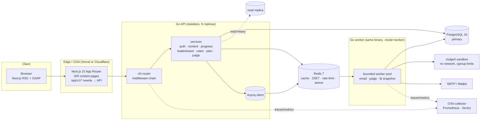
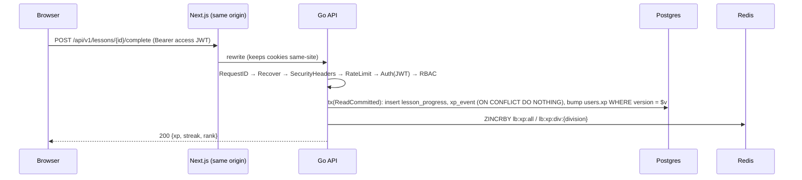

# Coding Foding — Architecture

> "Everything you need, in one path." — `</> WHY → CODE → CRACK`

This document covers deliverables **1 (architecture + trade-offs)** and **2 (monorepo layout)**.
Schema details live in [`DATABASE.md`](./DATABASE.md).

---

## 1. System overview



### Request lifecycle (authenticated write)



## 2. Key decisions & trade-offs

| Decision | Why | Trade-off |
|---|---|---|
| **Modular monolith** (Go) | One deploy, one DB tx boundary, fast iteration. Each module (`auth`, `content`, `progress`, `leaderboard`, `vote`, `plan`, `judge`) owns its service + repo interface in `internal/domain`, so it can be split later. | Must police imports (`service` never imports `transport`; modules talk via interfaces). |
| **Same-origin API via Next.js rewrite** | Refresh cookie is first-party (`SameSite=Strict`), no CORS preflight in the browser, one CSP origin. | Extra hop through Next in dev; in prod the CDN routes `/api/*` straight to the API. |
| **Access JWT (15m, memory) + rotating refresh (httpOnly cookie)** | Stateless authZ on hot paths; refresh rotation with *reuse detection* (token family revoke) limits stolen-token blast radius. | Revocation of access tokens is delayed ≤15m (acceptable; admin role changes also bump session revoke). |
| **CSRF: double-submit token** on cookie-authenticated endpoints only (`/auth/refresh`, `/auth/logout`) | Bearer-auth endpoints are not CSRF-able; cookie endpoints get `X-CSRF-Token` = `cf_csrf` cookie check. | Client must echo the header (handled in `apiFetch`). |
| **sqlc + pgx/v5** | Compile-time checked SQL, zero reflection, parameterized by construction. | Dynamic filters need explicit query variants (we use nullable params: `sqlc.narg`). |
| **Translations in side tables** (`*_translations`, PK `(id, locale)`) | Add locales without migrations; per-locale status (`draft/outdated/done`); `en` fallback via one `LEFT JOIN` (no N+1). | Two joins per read → mitigated by Redis cache-aside keyed `lesson:{id}:{locale}`. |
| **Outdated detection in a DB trigger** | Invariant holds no matter which writer (admin UI, SQL, migration) touches `en`. | Logic lives partly in SQL — documented in migration. |
| **Leaderboard = Redis ZSET + Postgres snapshots** | `ZREVRANK`/`ZCARD` are O(log N) → percentile in microseconds; snapshots give history + rebuild source. | Redis is not source of truth: `xp_events` is. A rebuild job re-hydrates ZSETs from Postgres. |
| **Optimistic locking (`version`)** on `users` (xp/streak) and `plans` | Hot rows, low conflict probability; avoids long row locks. Retry ×3 on conflict. | Retries under extreme contention — bounded and observable. |
| **Asynq on Redis** for jobs | Retries with exponential backoff, dead-letter ("archived"), unique tasks, cron scheduler — no extra infra. | Redis must be persistent (AOF) in prod. |
| **Judge0** behind a `Judge` interface | Battle-tested sandbox (isolate + cgroups, no network). We never run user code in the API process. | External dependency; interface lets us swap for Firecracker later. |
| **UUID v7 PKs** | Time-ordered → B-tree locality, cursor pagination by id, no enumeration. | 16 bytes vs 8 — fine. |
| **GSAP + ScrollTrigger + MotionPath** for the journey | Precise scrubbed timelines, `transform`-only, robust cleanup with `useGSAP`. Loaded via `dynamic()` below the fold. | ~60 KB gz — lazy so LCP is untouched. |
| **CSS variables + `data-theme`** + blocking inline script | No wrong-theme flash; themes are pure data. | One tiny inline script → whitelisted via CSP nonce. |
| **next-intl with `/en` `/bn` prefixes** | SEO-friendly `hreflang`, static params per locale. | Every route lives under `[locale]`. |

### Assumptions (stated, per brief)

1. **Judge**: Judge0 CE is self-hosted separately (it needs privileged containers). Local compose ships without it; submissions stay `queued` until `JUDGE0_URL` is set.
2. **Next.js 15** pinned (brief says 15; 16 exists).
3. **Divisions**: the 8 administrative divisions of Bangladesh; `NULL` = not set (still ranked nationally).
4. **Streak** uses the `Asia/Dhaka` calendar day.
5. **XP** is append-only (`xp_events`); `users.xp` is a denormalized counter.
6. **Default locale** for new users is `bn` (brief), for anonymous visitors `Accept-Language` decides.

## 3. Monorepo layout

```
.
├── apps/
│   ├── api/                      # Go modular monolith
│   │   ├── cmd/api               # main.go: wiring, graceful shutdown, -mode=api|worker|all
│   │   ├── cmd/migrate           # goose up/down/status (embedded SQL)
│   │   ├── cmd/seed              # demo content + leaderboard data
│   │   ├── db/queries            # sqlc input (*.sql)
│   │   ├── internal/config       # env-based 12-factor config
│   │   ├── internal/domain       # entities, errors, repository/service interfaces
│   │   ├── internal/service      # use cases (pure Go, unit tested with fakes)
│   │   ├── internal/repository   # postgres (sqlc gen + adapters), redis
│   │   ├── internal/transport/http  # router, middleware, handlers, DTOs, OpenAPI
│   │   ├── internal/worker       # asynq tasks: email, judge, leaderboard snapshot
│   │   ├── pkg                   # httpx, security (argon2id, jwt), uuid, clock
│   │   └── migrations            # goose SQL (embedded)
│   └── web/                      # Next.js 15 App Router
│       ├── messages/{en,bn}.json
│       ├── src/app/[locale]/...  # routes
│       ├── src/components/journey  # signature GSAP section
│       ├── src/lib/{api,theme,i18n,journey}
│       └── e2e/                  # Playwright + axe
├── packages/ui                   # shared accessible primitives (Radix + Tailwind)
├── content/glossary.json         # terms that stay English in bn content
├── infra/docker                  # Dockerfiles, compose
├── infra/k6                      # load tests
├── .github/workflows             # CI
└── docs/
```
