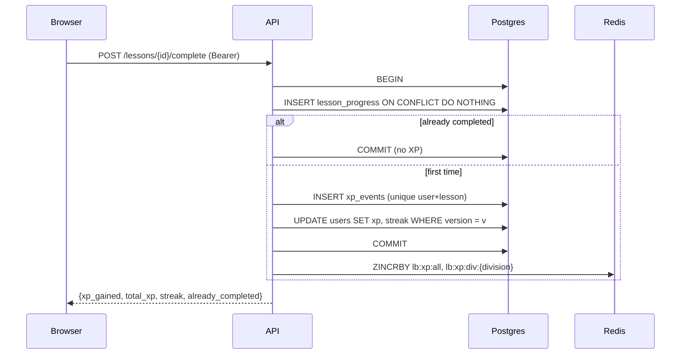
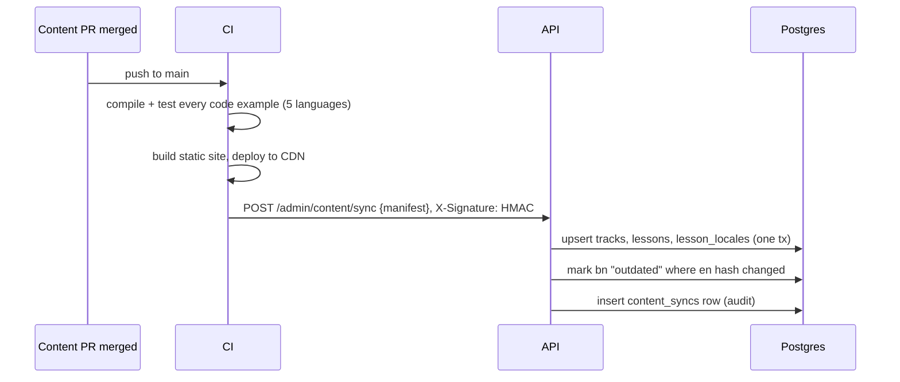
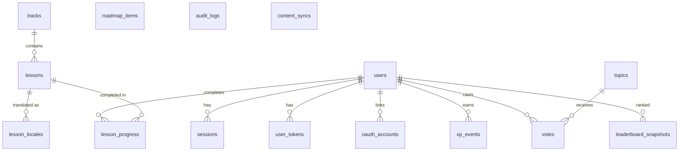

# Coding Foding — Backend Design (v1)

> Status: **design, pre-implementation.** Supersedes the backend parts of
> [`ARCHITECTURE.md`](./ARCHITECTURE.md) where they disagree.
> Order: **Part 1 First principles → Part 2 HLD → Part 3 LLD.**

**v1 scope in one line:** accounts, learning progress (XP + streak), the Bangladesh leaderboard,
community "Most needed" votes, and the public roadmap. **Problem solving (judge, submissions,
AI/ML problems) is out of v1.**

---

# Part 1 — First principles

## 1.1 What the backend is *for*

Strip everything away and the backend does four jobs:

1. **Remember who you are** — identity, sessions, preferences (locale, theme, font).
2. **Remember what you did** — which lessons you finished, the XP that earned, your streak.
3. **Compare you with others** — rank and percentile, nationally and per division.
4. **Let the community steer** — vote on what to build; read what is coming (roadmap).

It does **not** store or serve the learning content itself. Lessons, code examples and blogs are
files in Git, rendered at build time (see 1.4). The backend only knows *that* a lesson exists
(its stable id, track, XP value, translation status).

## 1.2 Actors

| Actor | Does | Volume |
|---|---|---|
| Anonymous visitor | Reads content (CDN), leaderboard, roadmap, topics | ~90% of traffic |
| Learner | Completes lessons, votes, proposes topics, changes preferences | Most writes |
| Admin | Edits roadmap, moderates topics, triggers content sync | A handful of people |
| CI (content repo) | Tells the backend "content changed, sync metadata" | Per merge |
| Worker | Sends email, snapshots leaderboard, repairs Redis | Background |

## 1.3 What must never be wrong vs. what may lag

This single table drives most design decisions.

| Data | Must be exact? | Why | Consequence |
|---|---|---|---|
| Passwords, sessions, tokens | **Exact, secure** | Account takeover | argon2id, hashed tokens, rotation |
| XP ledger (`xp_events`) | **Exact, idempotent** | It *is* the ranking; double-award = cheating | Unique key per (user, source); one transaction |
| One vote per user per topic | **Exact** | Fairness | Primary key `(user_id, topic_id)` |
| `users.xp`, streak | Exact, derived | Shown on profile | Same tx as ledger; optimistic lock |
| Leaderboard rank | **May lag seconds** | Nobody notices 2 s | Redis ZSET; rebuilt from ledger if lost |
| Topic vote count | May lag | Display only | Counter in same tx; recomputable |
| Roadmap, track metadata | May lag minutes | Changes rarely | Cache + ETag + CDN |

**Principle:** Postgres is the source of truth for everything. Redis only holds things that can be
rebuilt from Postgres (rankings, caches, rate-limit counters, job queue).

## 1.4 Why content lives in Git, not the database

| Need | Git files + build-time render | DB + admin editor |
|---|---|---|
| Code examples in 5 languages that actually run | **CI compiles and tests every example** | No guarantee |
| Review before publish | Pull request | Custom workflow to build |
| Community contributions | GitHub PR | Accounts + permissions to build |
| Speed / availability | Static pages on CDN; API down ≠ content down | Every page hits API/DB |
| bn translation tracking | Hash of the en source in bn frontmatter | DB trigger (current code) |

So: **Git = content body. DB = content metadata + user data.** A sync step (Part 3.7) copies
metadata (ids, track, position, XP, translation status) from Git into Postgres on every merge.

## 1.5 Back-of-envelope sizing (Bangladesh, first 2 years)

| Quantity | Estimate |
|---|---|
| Registered users | 100 k |
| Daily active | 10 k |
| Peak concurrent | ~1 k (evenings, exam season) |
| Lesson completions | 10 k DAU × 5/day = 50 k/day ≈ **0.6 write/s avg, ~10/s peak** |
| API reads (leaderboard, me, topics, roadmap) | ~50 req/s peak, most CDN/Redis-cacheable |
| `xp_events` growth | 50 k/day × 365 ≈ 18 M rows/yr × ~120 B ≈ **2 GB/yr** |
| Leaderboard ZSET | 100 k members ≈ 10 MB per board × 9 boards |
| Users table | 100 k × ~1 KB ≈ 100 MB |

**Conclusion:** this is a *small* system. One Postgres primary, one Redis, 2 API replicas (for
availability, not load) are plenty. Complexity budget goes to **correctness and security**, not
to scale. Design for 10× without re-architecture: read replica + more API replicas.

## 1.6 Non-functional requirements

| | Target |
|---|---|
| API p95 latency | < 100 ms (reads), < 200 ms (writes) |
| Availability | 99.5 % (single region; content stays up via CDN even if API is down) |
| Durability | Postgres daily backup + PITR (WAL) |
| Security | OWASP Top 10; no plaintext secrets/tokens at rest; rate limits on all auth |
| Privacy | Public profile shows no email; PII minimal; passwords/tokens never logged |
| Locale | Every user-facing string available in `en` + `bn`, `en` fallback |

## 1.7 Explicitly out of v1

Problem solving (judge, submissions, AI/ML problems), personal study plans, contests,
in-app notifications, mentorship, blogs comments. The schema leaves room for them; none are built.

---

# Part 2 — High Level Design (HLD)

## 2.1 System context

```mermaid
flowchart LR
  subgraph Git["GitHub: content repo"]
    C[lessons/*.md<br/>examples/*.{cpp,go,py,java,js}<br/>blogs/*.md]
  end
  CI[CI: test examples,<br/>build site]
  CDN[CDN + Next.js<br/>static pages]
  U[Browser]
  API[Go API<br/>modular monolith]
  W[Go worker<br/>same binary]
  PG[(PostgreSQL 16)]
  R[(Redis 7)]
  M[SMTP]

  C --> CI --> CDN
  CI -- "POST /admin/content/sync (HMAC)" --> API
  U --> CDN
  U -- "/api/v1/* (same origin)" --> API
  API --> PG
  API --> R
  R -- jobs --> W
  W --> PG
  W --> M
```

## 2.2 Components

| Component | Responsibility | Stateless? |
|---|---|---|
| **Next.js on CDN** | Renders content from Git at build time; proxies `/api/v1/*` to the API (same origin → first-party cookies) | Yes |
| **API** (`-mode=api`) | HTTP, auth, business rules | Yes — scale horizontally |
| **Worker** (`-mode=worker`) | Email, leaderboard snapshot + nightly rebuild, session cleanup, content-sync jobs | Yes |
| **PostgreSQL** | Source of truth | — |
| **Redis** | Leaderboard ZSETs, cache, rate limits, login lockout, job queue (Asynq) | Rebuildable |

## 2.3 Modules (inside the monolith)

Each module owns its tables and talks to others only through Go interfaces, so any one can later
be split into a service.

| Module | Owns tables | Depends on |
|---|---|---|
| **identity** | users, sessions, user_tokens, oauth_accounts | mail (via jobs) |
| **catalog** | tracks, lessons, lesson_locales, content_syncs | — |
| **progress** | lesson_progress, xp_events | catalog (lesson XP), leaderboard (port) |
| **leaderboard** | leaderboard_snapshots (+ Redis) | identity (names), progress (ledger for rebuild) |
| **community** | topics, votes | identity |
| **roadmap** | roadmap_items | — |
| **admin** | audit_logs | all (via their services) |

## 2.4 API surface (v1)

All under `/api/v1`. JSON. Errors: `{"error":{"code","message","request_id"}}`. Cursor pagination.

| Area | Endpoint | Auth | Cache |
|---|---|---|---|
| Auth | `POST /auth/register` · `/login` · `/refresh` · `/logout` | public / cookie+CSRF | no-store |
| | `POST /auth/verify-email` · `/forgot-password` · `/reset-password` | public | no-store |
| | `GET /auth/oauth/{google\|github}/start` · `/callback` | public | — |
| Me | `GET /me` · `PATCH /me` (name, locale, theme, font, division) | bearer | private |
| | `GET /me/progress?track=dsa` → completed lesson ids + XP + streak | bearer | private |
| | `GET /me/standing?division=` → rank, percentile, top-1 % flag | bearer | private |
| Profile | `GET /users/{username}` (public, no email) | public | 60 s |
| Catalog | `GET /tracks` · `GET /tracks/{slug}` (lesson ids, titles, XP, `translated`) | public | ETag, 5 min |
| Progress | `POST /lessons/{id}/complete` (idempotent) | bearer | — |
| Leaderboard | `GET /leaderboard?division=&limit=&cursor=` | public | 10 s |
| Community | `GET /topics?cursor=` · `POST /topics` | public / bearer | 30 s |
| | `PUT /topics/{id}/vote` · `DELETE /topics/{id}/vote` (idempotent) | bearer | — |
| Roadmap | `GET /roadmap` (Next / Horizon / Plan, localized) | public | ETag, 5 min |
| Admin | `POST/PATCH/DELETE /admin/roadmap[/{id}]` · `PATCH /admin/topics/{id}` | admin | — |
| | `POST /admin/content/sync` (CI, HMAC-signed) · `GET /admin/audit-logs` | admin / CI | — |
| Ops | `/healthz` · `/readyz` · `/metrics` (separate port) | — | — |

## 2.5 Key flows

**Complete a lesson** (the hot write path)



If Redis fails after commit, the ledger is still correct; the nightly rebuild repairs the board.

**Content published**



**Refresh token rotation with reuse detection** — every refresh issues a new refresh token and
revokes the old one. Presenting an already-revoked token means it was stolen: revoke the whole
token family and force re-login.

## 2.6 Data stores

| Store | What | Why this store |
|---|---|---|
| Postgres | Everything durable | Transactions, constraints enforce the "must be exact" rows |
| Redis ZSET `lb:xp:all`, `lb:xp:div:{d}` | Live ranking | `ZREVRANK` + `ZCARD` → percentile in O(log N) |
| Redis strings `cache:*` | Tracks, roadmap, public profiles | Cache-aside, short TTL, explicit invalidation |
| Redis hashes `rl:*` | Token buckets | Shared across API replicas, atomic Lua |
| Redis `guard:login:{email}` | Failed-login counter | Lockout after 5 fails / 15 min |
| Asynq (Redis) | Jobs | Retries, backoff, dead-letter, cron |

## 2.7 Cross-cutting

- **Auth:** access JWT 15 min (in memory on the client) + refresh token 30 days (httpOnly,
  Secure, SameSite=Strict cookie scoped to `/api/v1/auth`). CSRF double-submit on the two
  cookie-authenticated endpoints. RBAC roles: `learner`, `mentor`, `admin`.
- **Rate limits:** auth 10/min per IP, writes 60/min per user, reads 300/min per IP.
- **Observability:** structured JSON logs (slog) with request id; Prometheus RED metrics per
  route; OpenTelemetry traces; Sentry for panics.
- **Deploy:** one container image, two process modes; migrations run as a release step.
- **Failure modes:** Redis down → leaderboard/rate-limit degrade (fail open, logged), core writes
  still work; Postgres down → `/readyz` fails, load balancer drains; content stays up on CDN.

## 2.8 Scaling path (when, not now)

1. Read-heavy growth → Postgres read replica for leaderboard hydrate, public profiles, topics.
2. More API replicas behind the LB (already stateless).
3. If progress writes ever dominate → move `progress` + `leaderboard` modules to a service with
   its own DB, communicating via an outbox table. The module boundaries above make this mechanical.

---

# Part 3 — Low Level Design (LLD)

## 3.1 Go package layout

```
apps/api/
  cmd/api/main.go            wiring, -mode=api|worker|all, graceful shutdown
  cmd/migrate/               goose up/down/status (embedded SQL)
  cmd/seed/                  demo users, topics, roadmap, XP
  internal/config/           env → typed Config, validated at boot
  internal/domain/           entities, typed errors, ports (interfaces) — no imports from below
  internal/service/          identity, catalog, progress, leaderboard, community, roadmap, admin
  internal/repository/
    postgres/                sqlc-generated + adapters, tx-in-context
    redis/                   board, cache, ratelimit, loginguard
  internal/transport/http/   router, middleware, handlers, DTOs, OpenAPI
  internal/worker/           Asynq tasks + scheduler
  internal/mail/             SMTP sender + bn/en templates
  pkg/                       security (argon2id, jwt, tokens), clock, id (uuidv7), cursor
  migrations/
```

**Dependency rule:** `transport → service → domain ← repository`. Services never import
`transport`, `postgres` or `redis` — only `domain` interfaces. Unit tests use in-memory fakes.

## 3.2 Database schema (v1)



| Table | Key columns | Constraints / indexes |
|---|---|---|
| `users` | id (uuidv7), email citext, username citext, display_name, password_hash?, role, preferred_locale, theme, **font**, division?, xp, current_streak, longest_streak, last_active_date, version, timestamps, deleted_at | partial unique (email), (username) where not deleted; index (xp desc) |
| `sessions` | id, user_id, family_id, token_hash (sha256), expires_at, revoked_at, replaced_by | unique token_hash; index family_id |
| `user_tokens` | id, user_id, kind (verify\|reset), token_hash, expires_at, used_at | unique token_hash |
| `oauth_accounts` | user_id, provider, provider_user_id | unique (provider, provider_user_id) |
| `tracks` | id, slug, position, **journey_position?** (null = Learn-only track) | unique slug |
| `lessons` | id (**stable, from Git frontmatter**), track_id, slug, position, xp_reward, en_hash, is_published | unique (track_id, slug) |
| `lesson_locales` | lesson_id, locale, title, source_hash, status (done\|outdated\|draft) | PK (lesson_id, locale) |
| `lesson_progress` | user_id, lesson_id, completed_at | PK (user_id, lesson_id) |
| `xp_events` | id, user_id, amount, source_type, source_id, created_at | **unique (user_id, source_type, source_id)** |
| `leaderboard_snapshots` | taken_at, division?, user_id, rank, xp, percentile | index (taken_at, division, rank) |
| `topics` | id, slug, title_en, title_bn, tag, vote_count, status (open\|planned\|hidden), created_by | index (vote_count desc, id) |
| `votes` | user_id, topic_id | **PK (user_id, topic_id)** |
| `roadmap_items` | id, stage (next\|horizon\|plan), kind, position, title {en,bn}, desc {en,bn}, progress?, topic_id? | index (stage, position) |
| `audit_logs` | actor_id, action, entity, diff jsonb, ip, request_id | index (entity, created_at) |
| `content_syncs` | id, commit_sha, started_at, finished_at, stats jsonb, error? | unique commit_sha |

**Seed tracks:** `why`(journey 1), `programming`(2), `dsa`(3), `os`(4), `networking`(5),
`system-design`(6, with LLD/HLD sections), `frontend-system-design`(Learn only),
`backend-first-principles`(Learn only).

**Delta from the code already written:** the existing `00001_init.sql` was never deployed, so it
is rewritten rather than migrated: drop `paths`, `milestones`, `*_translations`, `problems`,
`submissions`, `plans`, `plan_items`, `notifications`; add `tracks`, `lesson_locales`,
`roadmap_items`, `content_syncs`, `users.font`; replace the translation trigger with hash-based
status computed during sync.

## 3.3 Core algorithms

**Award XP (idempotent + optimistic lock)**

```
retry up to 3 times on VersionConflict:
  tx:
    inserted := INSERT lesson_progress ... ON CONFLICT DO NOTHING
    if !inserted: return current state (already_completed = true)
    state := SELECT xp, streak, last_active_date, version, division FROM users WHERE id = $u
    INSERT xp_events (user, 'lesson', lesson_id, amount) ON CONFLICT DO NOTHING
    streak := nextStreak(state.last_active_date, state.streak, today(Asia/Dhaka))
    rows := UPDATE users SET xp = xp + amount, streak..., version = version + 1
            WHERE id = $u AND version = state.version
    if rows == 0: raise VersionConflict
after commit: ZINCRBY national + division boards (failure logged, repaired nightly)
```

**Streak** (calendar days in Asia/Dhaka): same day → unchanged (min 1); yesterday → +1;
older or never → 1.

**Percentile** for rank `r` of `n`: `top_percent = r / n × 100`;
`in_top_1_percent = r ≤ ceil(n × 0.01)` (so a board of 50 still has a top-1 % user).

**Vote toggle:** in one tx: check topic exists → `INSERT votes ON CONFLICT DO NOTHING` (or
`DELETE`) → only if a row changed, `UPDATE topics SET vote_count = vote_count ± 1 RETURNING`.
Double clicks and retries are no-ops.

**Leaderboard rebuild** (nightly + on empty Redis at boot): page through `users ORDER BY xp`,
build each board under a temp key, then `RENAME` → readers never see a half-built board.

## 3.4 Auth details

| Step | Rule |
|---|---|
| Password | argon2id m=64 MiB, t=2, p=1; PHC string; 10–128 chars |
| Login | Constant-time path for unknown email (dummy hash); 5 fails / 15 min → `423 Locked` |
| Access token | HS256, 15 min, claims `sub, role, iss, aud, jti` |
| Refresh token | 256-bit random, only sha256 stored, 30 days, rotates on every use; reuse → revoke family |
| Email verify / reset | 256-bit random, sha256 stored, 24 h / 30 min, single use; reset revokes all sessions |
| OAuth | state + PKCE in a signed, httpOnly, 10-min cookie; link to existing account only if provider says email is verified |
| Cookies | `cf_rt` httpOnly Secure SameSite=Strict Path=/api/v1/auth; `cf_csrf` readable, double-submit |

## 3.5 Redis keys

| Key | Type | TTL | Notes |
|---|---|---|---|
| `lb:xp:all`, `lb:xp:div:{division}` | ZSET | none | member = user uuid, score = xp |
| `cache:tracks:{locale}` | string (JSON) | 5 min | invalidated by content sync |
| `cache:roadmap:{locale}` | string (JSON) | 5 min | invalidated by admin write |
| `cache:profile:{username}` | string (JSON) | 60 s | |
| `rl:{bucket}:{ip\|user}` | hash | ≈ refill time | token bucket via Lua |
| `guard:login:{email}` | string counter | 15 min | lockout |

## 3.6 Background jobs (Asynq)

| Task | Queue | Trigger | Retry |
|---|---|---|---|
| `email:send` | default | register, forgot-password | 8, exp. backoff |
| `content:sync` | default | CI webhook (API enqueues, returns 202) | 3 |
| `leaderboard:snapshot` | low | every 10 min | 3 |
| `leaderboard:rebuild` | low | daily 03:30 + boot if empty | 3 |
| `sessions:cleanup` | low | daily 03:00 | 3 |

Worker concurrency is bounded (default 10); queue weights critical 6 / default 3 / low 1.

## 3.7 Content sync (Git → DB)

Lesson frontmatter (one file per locale):

```yaml
---
id: 0192f7a4-6c1e-7b2a-9d3e-1f2a3b4c5d6e   # stable forever, generated once
track: dsa
slug: two-pointers
position: 3
xp: 20
locale: bn
title: Two Pointers pattern
translated_from: 9f2c…                      # sha256 of the en body this bn was written from
---
```

CI builds a manifest (`[{id, track, slug, position, xp, locales: {en: {title, hash}, bn: {title, source_hash}}}]`),
signs it with HMAC-SHA256, and POSTs it. The sync job, in one transaction:

1. Upserts tracks and lessons by `id` (never by slug — slugs can be renamed).
2. Upserts `lesson_locales`; `bn.status = done` if `bn.source_hash == en.hash`, else `outdated`;
   missing bn → no row (UI shows "এখনো বাংলায় আসেনি").
3. Lessons missing from the manifest → `is_published = false` (progress and XP are kept).
4. Records a `content_syncs` row; idempotent on `commit_sha`.

## 3.8 Errors, validation, pagination

- Typed domain errors → HTTP: invalid 422, not found 404, conflict 409, unauthorized 401,
  forbidden 403, rate limited 429 (+ `Retry-After`), locked 423, internal 500 (cause logged only).
- Request bodies ≤ 1 MiB, unknown JSON fields rejected, struct-tag validation.
- Cursor = base64url JSON of the last row's sort key (e.g. `{v: vote_count, i: id}`); never offsets.

## 3.9 Testing plan

| Layer | How |
|---|---|
| Algorithms (streak, percentile, vote, XP retry) | Table-driven unit tests with fakes |
| Repositories + constraints | Integration tests on real Postgres (testcontainers) — e.g. 100 parallel votes by one user → count 1 |
| HTTP | `httptest` for error envelope, auth middleware, CSRF, rate-limit headers |
| Concurrency | `go test -race` in CI |
| Load | k6: leaderboard read + lesson complete at 1 k virtual users |

## 3.10 Build order (after this doc is approved)

1. Rewrite migration + sqlc queries for the v1 schema above.
2. identity → catalog + content sync → progress → leaderboard → community → roadmap.
3. HTTP layer + OpenAPI; `docker compose up` (Postgres, Redis, Mailpit, API, worker).
4. Seed data; connect the web app (replace "Preview data").

---

## Open questions

1. **Divisions:** keep the 8 administrative divisions as the leaderboard filter?
2. **XP values:** flat per lesson (e.g. 10/20/30 by length) or set per lesson in frontmatter?
3. **Roadmap ↔ Most needed:** link a roadmap item to the topic that inspired it (`topic_id`)?
4. **Content repo:** start inside this monorepo (`content/`) and split later — OK?
